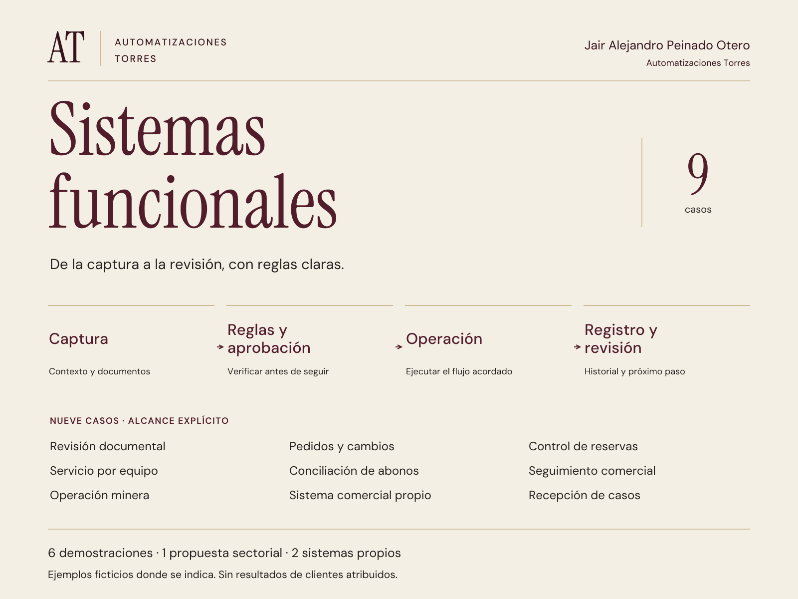

# Automatizaciones Torres

**6 demostraciones funcionales · Español / English**

Diseñamos sistemas para que un proceso pueda recorrerse de principio a fin, con reglas claras, excepciones visibles y aprobación humana donde corresponde.

[Explorar las demostraciones](https://demo.automatizacionestorres.com) · [Conocer Automatizaciones Torres](https://automatizacionestorres.com)

## Seis recorridos para probar

Cada demostración permite cambiar entradas y observar una decisión. Los datos son ficticios y las reglas se ejecutan en el navegador; no representan implantaciones de clientes ni resultados comerciales acreditados.

| Recorrido / Workflow | Qué permite comprobar / What you can test |
|---|---|
| Expedientes / Document packets | Periodo, soporte adjunto y aprobación antes de avanzar. / Period, attachment and approval checks before proceeding. |
| Cambios de pedido / Order changes | Diferencias respecto de una base y autorización para producción. / Baseline differences and production approval. |
| Existencias / Inventory | Disponibilidad, cantidades comprometidas y reserva sin duplicación. / Availability, committed units and a reservation that cannot be repeated. |
| Equipos / Equipment intake | Identificación, autorización y soporte para revisar un servicio. / Identification, authorization and evidence for service review. |
| Abonos / Receipts | Diferencias y referencia antes de conciliar; el modelo no reconoce ingresos. / Differences and reference checks before reconciliation; the model recognizes no income. |
| Seguimiento comercial / Commercial follow-up | Fuente, canal, historial, supresión y aprobación antes de avanzar. / Source, channel, history, suppression and approval checks. |

También se puede preparar una ficha local de un proceso. La información permanece en el navegador hasta que la persona decide compartirla; modificar la ficha invalida la versión generada. El volumen de tareas declarado es una entrada para conversar, no ahorro demostrado. Consulta la [guía del recorrido](docs/FIRST_WORKFLOW.md) y los [límites de las demostraciones](docs/DEMONSTRATION.md).

Ninguna acción de estos modelos mueve inventario, confirma dinero, envía correos, crea citas o contacta personas en un sistema real. No hay un servicio de IA externo o un backend operativo conectado a las seis simulaciones.

## Portafolio en español e inglés

El dossier reúne nueve casos de distinto alcance: seis demostraciones con datos ficticios, una propuesta sectorial y dos productos propios. Esa clasificación se mantiene en las imágenes y los documentos; no equivale a nueve clientes ni a nueve implementaciones en una plataforma determinada.

[Leer el dossier en español (PDF)](portfolio-v36/dossier/Automatizaciones_Torres_Portafolio_ES.pdf) · [Read the English portfolio (PDF)](portfolio-v36/dossier/Automatizaciones_Torres_Portafolio_EN.pdf)

Los [recursos del portafolio](portfolio-v36/manifest.json) incluyen portadas en ambos idiomas, marca, paleta y un inventario SHA-256. Las propuestas de medida son criterios para una futura prueba; no son ROI, ingresos o ahorros de clientes.

## Ejecutar y comprobar

Sirve la carpeta estática desde un entorno con Python instalado:

~~~sh
python -m http.server 4185 --bind 127.0.0.1 --directory dist
~~~

Abre http://127.0.0.1:4185. Los modelos y la ficha funcionan localmente con los archivos incluidos; no necesitan una cuenta, un servicio externo de IA o analítica activa.

Con Node.js, ejecuta las pruebas de los modelos y de la ficha:

~~~sh
node --test tests/*.test.mjs
~~~

Son 38 pruebas locales de reglas, límites, aprobación, idempotencia y edición de la ficha. No requieren instalar dependencias ni contactar servicios externos. Las licencias OFL de las fuentes incluidas se conservan en [dist/assets/fonts](dist/assets/fonts).

## Analítica opcional

La publicación utiliza el ID público GA4 G-GGMRJRJKQF. El módulo sólo permite analítica en los dominios públicos HTTPS admitidos y después de aceptar expresamente. En localhost, otros hosts o sin consentimiento, las funciones siguen disponibles sin cargar Google ni enviar los eventos de uso. Rechazar o retirar el permiso mantiene las demostraciones operativas; no se acumulan acciones anteriores para enviarlas después.

El contrato usa categorías cerradas y URLs raíz canónicas. No recoge el contenido de formularios o fichas, correo, teléfono, empresa, documentos, tokens o identificadores de caso, ni une GA4 con registros comerciales. Google Signals, personalización publicitaria y consentimiento publicitario están desactivados. Un clic de contacto describe intención de abrir un canal; no prueba envío, lectura, respuesta o venta. La configuración del código por sí sola tampoco demuestra recepción en GA4.

## English

Automatizaciones Torres builds functional systems around an entire operational workflow. This repository contains six interactive, deterministic demonstrations with fictional data and explicit human approval controls. Change an input to inspect the resulting decision, then describe a process in a locally generated brief.

[Open the bilingual demonstration](https://demo.automatizacionestorres.com) or [read the English portfolio](portfolio-v36/dossier/Automatizaciones_Torres_Portafolio_EN.pdf). The extended portfolio distinguishes six demonstrations, one sector proposal and two own products. It makes no claim of client deployment, Shopify delivery, revenue or measured savings. The static models work locally without tracking; optional production analytics requires consent and excludes form contents and personal or operational identifiers.

## Derechos

© 2026 Automatizaciones Torres. Todos los derechos reservados. El acceso público al repositorio permite consultar la demostración; no concede una licencia de reutilización, modificación o distribución del código o del diseño. Para acordar otros usos, contactar a automatizaciones.storres@gmail.com.
