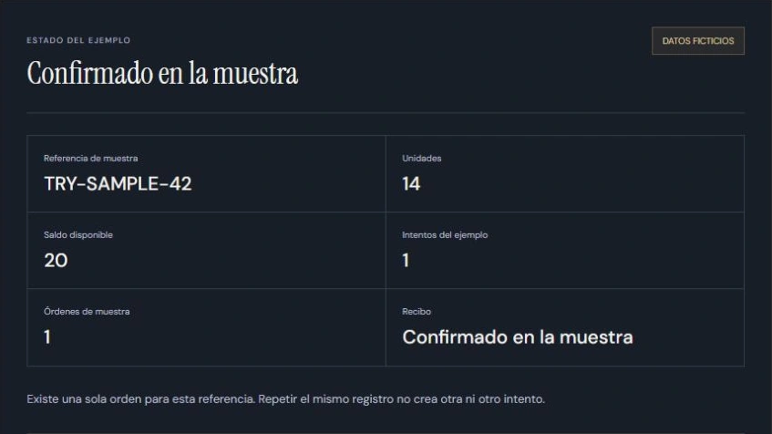

# Automatizaciones Torres

**9 desarrollos destacados · 6 laboratorios funcionales · Español / English**

Sistemas que conectan la entrada de un caso con sus reglas, decisiones, excepciones y siguiente paso. Cada desarrollo explica qué se construyó y permite recorrer una muestra independiente con datos ficticios.

[Explorar los desarrollos](https://demo.automatizacionestorres.com) · [Explore in English](https://demo.automatizacionestorres.com/en) · [Automatizaciones Torres](https://automatizacionestorres.com)

## Desarrollos destacados

Las fichas distinguen siete casos con funcionalidad desarrollada, un prototipo funcional y una tesis de producto con plan de validación. El contador representa casos de trabajo, no nueve clientes. Algunos módulos comparten una plataforma o un ecosistema de pedidos.

| Caso | Recorrido y estado del trabajo |
|---|---|
| [Expedientes](https://demo.automatizacionestorres.com/expedientes) | Aplicación funcional. Revisión de una versión vigente, aceptación, cierre y reapertura con historia. |
| [Consistencia documental](https://demo.automatizacionestorres.com/revision-documental) | Módulo funcional. Identidad, periodo y legibilidad antes de revisión humana. |
| [Operación de pedidos](https://demo.automatizacionestorres.com/pedidos) | Aplicación operativa. Intento incierto, consulta de recibo y repetición sin duplicar la operación. |
| [Portal de pedidos](https://demo.automatizacionestorres.com/portal-de-pedidos) | Portal funcional. Solicitud del cliente y resolución sobre la revisión vigente, con control de acceso simulado. |
| [Tienda y operación](https://demo.automatizacionestorres.com/tienda-y-operacion) | Tienda funcional publicada. Reporte del comprador, revisión administrativa y preparación separados. |
| [Transporte y liquidación](https://demo.automatizacionestorres.com/transporte-y-liquidacion) | Prototipo funcional y diseño operativo. Revisión de un viaje antes de su liquidación. |
| [Producto financiero operativo](https://demo.automatizacionestorres.com/producto-financiero-operativo) | Tesis de producto y validación documentadas. Revisar reglas y alcance antes de construir una plataforma extensa. |
| [Operación comercial](https://demo.automatizacionestorres.com/operacion-comercial) | Sistema propio implementado. Fuente, canal, historial, supresión y aprobación conservan estados diferentes. |
| [Recepción de casos](https://demo.automatizacionestorres.com/recepcion-de-casos) | Recepción funcional publicada. Revisión de una versión e intento con recibo antes de repetir. |

Las interacciones de este repositorio son reconstrucciones locales e independientes. No incluyen documentos, nombres, contactos o conexiones de clientes. Una muestra no activa servicios productivos, mueve inventario, confirma dinero, envía correos, crea citas o acredita resultados comerciales. Las cantidades son ficticias y las propuestas de medición no son ahorros o ROI observados.

## Seis laboratorios de reglas

Los modelos originales siguen disponibles en [/laboratorio](https://demo.automatizacionestorres.com/laboratorio) y [/en/lab](https://demo.automatizacionestorres.com/en/lab): expedientes, cambios de pedido, existencias y reservas, recepción de equipos, abonos y contexto comercial. Permiten cambiar entradas y observar límites, decisiones humanas e idempotencia.

Hay **34 rutas ES/EN con HTML propio**, para abrir enlaces directos y recargar. Los enlaces anteriores con `?caso=packet&idioma=es` conservan compatibilidad y llevan al laboratorio correspondiente. La [guía de rutas y controles](docs/V38_DEVELOPMENTS.md) describe los nueve recorridos y sus excepciones. El [contrato de los seis modelos](docs/DEMONSTRATION.md) conserva su API y sus límites.

## Ejecutar y comprobar

Se requiere una versión moderna de Node.js. No hay dependencias que instalar para los modelos, la vista previa o las pruebas.

~~~sh
node scripts/preview-v38.mjs 4199
~~~

Abrir http://127.0.0.1:4199/. La carpeta `dist` incluye las rutas generadas, fuentes locales y recursos necesarios. Las simulaciones funcionan sin un backend, cuenta o servicio externo de IA. La ficha de un proceso se prepara localmente; editarla invalida la versión generada. Copiar o descargar la ficha no la envía a otra persona.

~~~sh
node --test tests/*.test.mjs
node scripts/validate-v38.mjs
~~~

Son **69 pruebas** de reglas, roles, excepciones, estados, idempotencia, fichas y rutas. El validador adicional revisa las 34 páginas, sus recursos locales y el contrato CSP del consentimiento. Las pruebas automatizadas no sustituyen la revisión visual en un navegador. Para regenerar el HTML después de un cambio deliberado del catálogo o las rutas, ejecutar `node scripts/prepare-routes.mjs`.

## Privacidad y analítica opcional

La publicación utiliza el ID público GA4 G-GGMRJRJKQF. El módulo sólo permite analítica en los dominios públicos HTTPS admitidos y después de aceptar expresamente. En localhost, otros hosts o sin consentimiento, las funciones siguen disponibles sin cargar Google ni enviar eventos. Rechazar o retirar el permiso mantiene las demostraciones operativas; las acciones anteriores no se acumulan para enviarlas después.

El contrato permite únicamente eventos, rutas e identificadores públicos del catálogo incluidos en listas cerradas. No envía texto de formularios o fichas, correo, teléfono, empresa, documentos, valores del modelo ni identificadores operativos. No une GA4 con registros comerciales. Un clic de contacto indica intención de abrir un canal; no demuestra envío, lectura, respuesta o venta. La configuración del código por sí sola tampoco acredita recepción de eventos.

La fotografía de portada es ilustrativa y no representa al personal real. Las vistas de los casos muestran estas interfaces de demostración con datos ficticios. Las licencias OFL de las fuentes se conservan en [dist/assets/fonts](dist/assets/fonts).

## Archivo visual anterior

Se conserva el dossier de una edición anterior del portafolio, con su clasificación original de seis demostraciones, una propuesta sectorial y dos sistemas propios. El catálogo interactivo anterior y el actual tienen alcances distintos; las fichas actuales de esta página son la referencia para los nueve desarrollos destacados.

[Dossier anterior en español (PDF)](portfolio-v36/dossier/Automatizaciones_Torres_Portafolio_ES.pdf) · [Previous English portfolio (PDF)](portfolio-v36/dossier/Automatizaciones_Torres_Portafolio_EN.pdf)

El [inventario público de fuentes](docs/PUBLIC_SOURCE_INVENTORY.json) registra los archivos incorporados en esta edición. No incluye procedencia interna de clientes ni configuración del proveedor de alojamiento.

## English

Explore nine detailed development stories and six functional rule labs, with 34 direct-link pages in Spanish and English. Seven stories describe developed functionality, one is a working prototype and one is a documented product thesis and validation plan. This is a count of work cases, not nine customers. Some modules share a platform or order ecosystem.

Each story explains the challenge, what was built, the workflow, an exception, the human decision and the evidenced scope. All interactive examples in this repository are independent local reconstructions with fictional data. They do not expose customer systems or demonstrate measured revenue, savings, deployments in a particular third-party platform or live production integrations.

[Open the English catalogue](https://demo.automatizacionestorres.com/en) or [try the six original labs](https://demo.automatizacionestorres.com/en/lab). Run the Node commands above to serve the static files and check 69 tests plus the route validator. The simulations work without external AI or a business backend. Optional analytics is restricted to approved production HTTPS hosts, requires consent and excludes personal or operational data and form contents.

## Derechos / Rights

© 2026 Automatizaciones Torres. Todos los derechos reservados. El acceso público al repositorio permite consultar la demostración; no concede una licencia de reutilización, modificación o distribución del código o del diseño. Para acordar otros usos, contactar a automatizaciones.storres@gmail.com.

All rights reserved. Public access permits inspection of the demonstration; it does not grant a licence to reuse, modify or distribute its code or design. Contact automatizaciones.storres@gmail.com to arrange other uses. Bundled font licences remain in their respective files.
